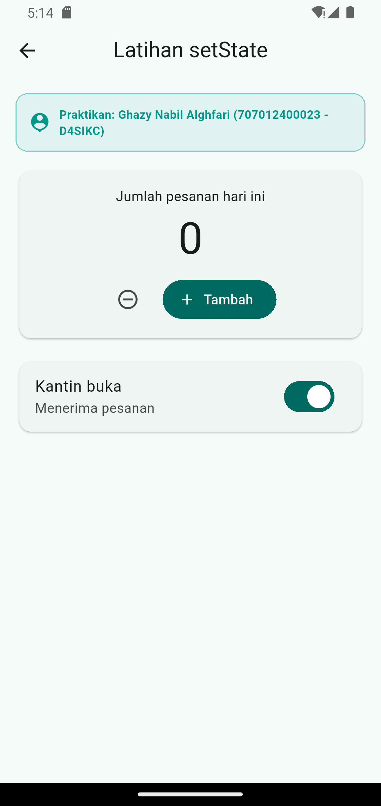
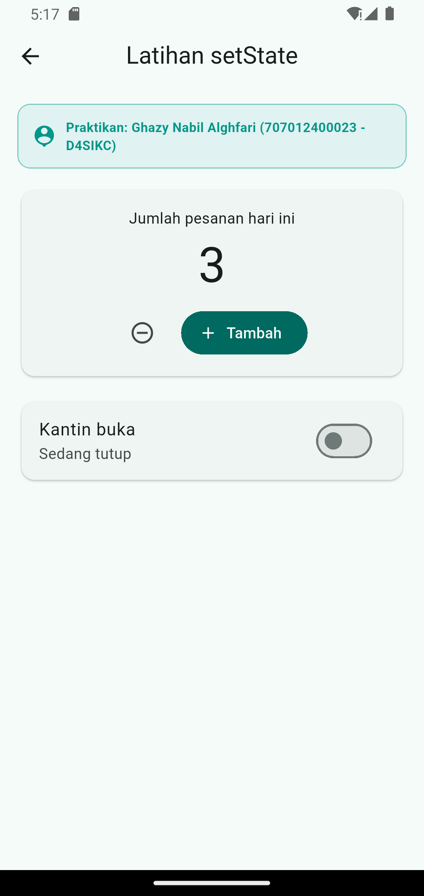
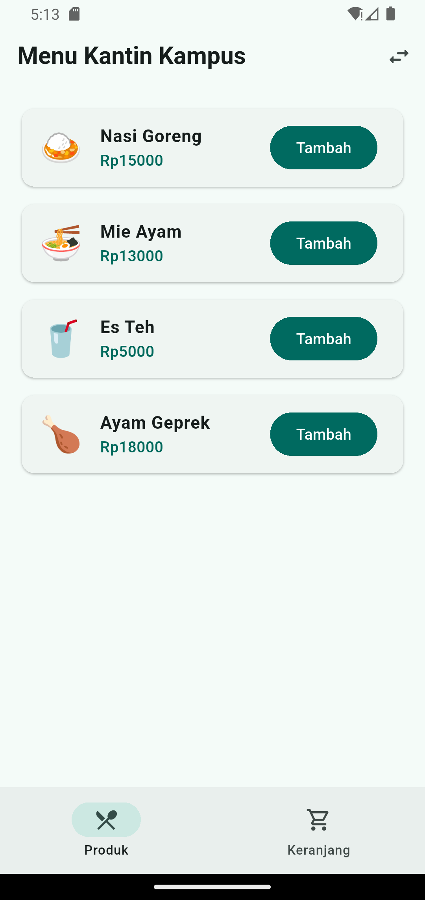
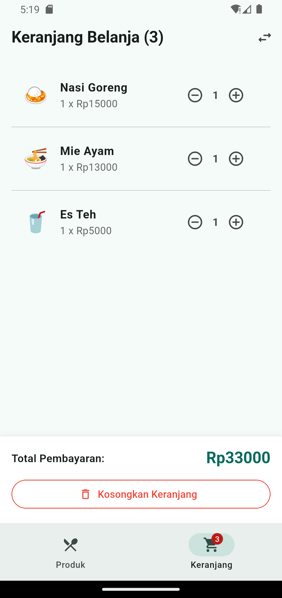
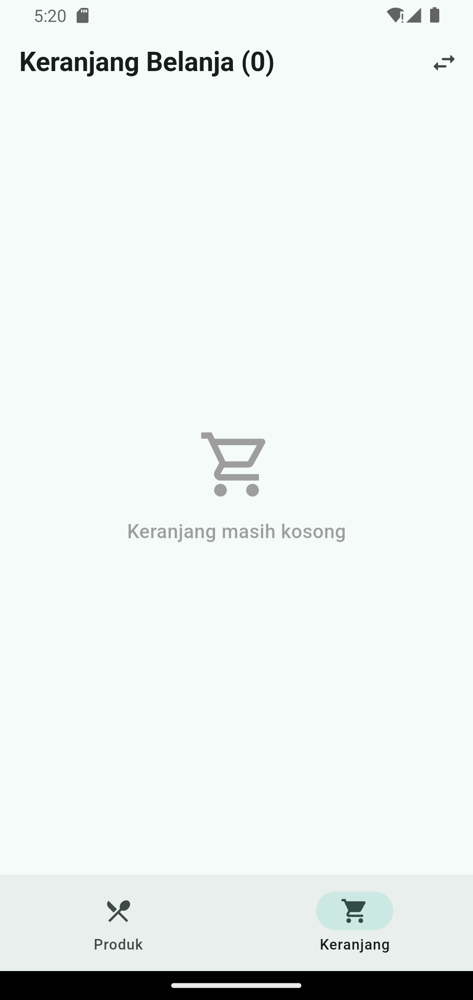

# Proyek Praktikum Modul 3: State Management dan Interaksi Pengguna (Kantin Kampus)

## 👤 Identitas Mahasiswa
* **Nama Lengkap:** Ghazy Nabil Alghfari
* **NIM:** 707012400023
* **Kelas:** D4SIKC (48-03)
* **Program Studi:** D4 Sistem Informasi Kota Cerdas (D4SIKC)
* **Fakultas:** Fakultas Ilmu Terapan (FIT)
* **Institusi:** Universitas Telkom
* **Akun GitHub:** [ghazyAlghifari508](https://github.com/ghazyAlghifari508)

---

## 📌 Deskripsi Proyek
Repositori ini berisi implementasi lengkap **Bagian E. Materi Praktikum** dari Modul 3 Praktikum Pengembangan Perangkat Bergerak Lanjut (PPBL). Proyek ini berfokus pada dua konsep fundamental pengelolaan state pada framework Flutter:

1. **Babak 1 — State Lokal (`setState()`)**: Pengelolaan state pada tingkat widget individual (`HalamanSetState`), mencakup counter pesanan dengan validasi proteksi nilai non-negatif serta switch interaktif untuk membuka/menutup operasional kantin.
2. **Babak 2 — State Aplikasi Bersama (`Provider` & `ChangeNotifier`)**: Pengelolaan keranjang belanja lintas halaman (`AplikasiKantin`), mencakup penambahan menu dari katalog (`HalamanProduk`), perhitungan total pembayaran dinamis di keranjang (`HalamanKeranjang`), serta badge counter notifikasi real-time pada navigasi utama (`KerangkaUtama`).

---

## 🏛️ Struktur Proyek & Arsitektur
```
state_interaksi_707012400023/
├── lib/
│   ├── main.dart                  # Titik masuk utama, ChangeNotifierProvider, & KerangkaUtama
│   ├── models/
│   │   └── keranjang_model.dart   # Model domain (Produk, ItemKeranjang, KeranjangModel)
│   └── pages/
│       ├── halaman_set_state.dart # Babak 1: Implementasi State Lokal (setState)
│       ├── halaman_produk.dart    # Babak 2: Katalog Produk (context.read)
│       └── halaman_keranjang.dart # Babak 2: Keranjang Belanja (Consumer & context.read)
├── test/
│   └── widget_test.dart           # Unit & Widget Testing otomatis (Babak 1 & Babak 2)
└── screenshots/                   # Dokumentasi tangkapan layar pengujian emulator
    ├── 01_setstate_awal.png
    ├── 02_setstate_diubah.png
    ├── 03_menu_kantin_awal.png
    ├── 04_tambah_produk_keranjang.png
    ├── 05_keranjang_belanja.png
    └── 06_kosongkan_keranjang.png
```

---

## 🧪 Pembuktian Pengujian (Automated Tests)
Proyek ini lolos uji analisis statis dan pengujian unit/widget:
* `flutter analyze` : **0 issues found** (Clean Code, strict linter compliance).
* `flutter test` : **All tests passed!** (Memverifikasi alur Babak 1 dan Babak 2).

---

## 📸 Dokumentasi Tangkapan Layar (Emulator Testing)

| Babak 1: Halaman SetState Awal | Babak 1: Halaman SetState Interaksi |
|:---:|:---:|
|  |  |
| *Counter awal 0, switch kantin buka* | *Counter bernilai 3, switch kantin tutup* |

| Babak 2: Katalog Menu Kantin | Babak 2: Menu Kantin (Item Ditambahkan) |
|:---:|:---:|
|  |  |
| *Daftar menu dengan badge keranjang 0* | *Badge keranjang terupdate menjadi 3* |

| Babak 2: Halaman Keranjang Belanja | Babak 2: Pengosongan Keranjang |
|:---:|:---:|
|  |  |
| *Ringkasan pesanan & total pembayaran Rp33.000* | *State tereset & tampilan keranjang kosong* |

---

## 🚀 Panduan Menjalankan Proyek
1. Pastikan Flutter SDK telah terpasang di komputer Anda.
2. Buka terminal pada root repositori ini.
3. Jalankan perintah instalasi pustaka:
   ```bash
   flutter pub get
   ```
4. Jalankan pengujian otomatis:
   ```bash
   flutter test
   ```
5. Jalankan aplikasi pada emulator atau perangkat fisik:
   ```bash
   flutter run
   ```
